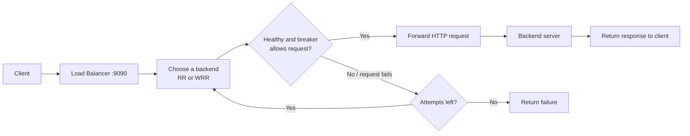
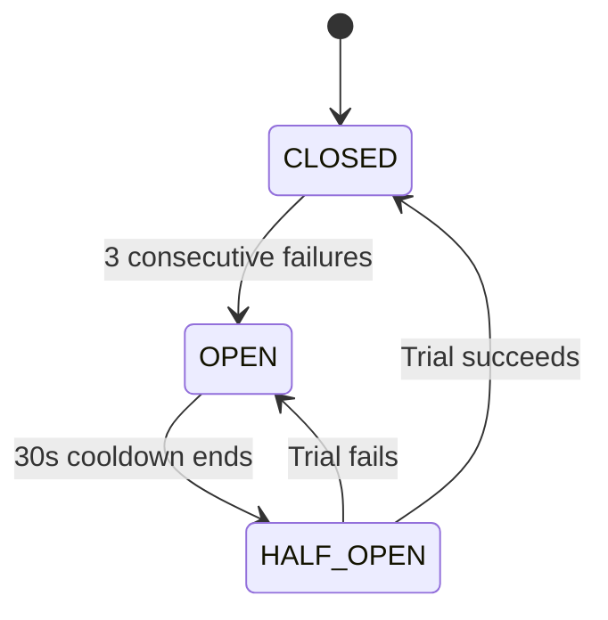

# Java Load Balancer

A Spring Boot Layer 7 HTTP load balancer that routes incoming requests across backend servers. It currently supports Round Robin and Weighted Round Robin, backend health checks, retries, timeouts, and per-server circuit breakers.


## How it works

Think of the load balancer as a traffic controller: clients send requests to one entry point, and it chooses a backend that can handle the request.

### Request flow



- **One entry point:** Clients call the LB on port `9090`; they don't need to choose a backend themselves.
- **Routing strategy:** Round Robin rotates through eligible servers. Weighted Round Robin gives servers more or less traffic according to their weight (Light: `3`, Heavy: `1`).
- **Health filtering:** A scheduled check calls each backend's `/health` endpoint every 60 seconds. Unhealthy servers are excluded until a later check marks them healthy.
- **Retries:** When a backend attempt fails, the LB can try another eligible server, up to the configured maximum attempts. Caller-side HTTP errors are treated separately from backend availability failures.
- **Timeouts:** Connection attempts have a `1s` timeout and response reads have a `2s` timeout. A slow backend can time out and the LB may try another backend.

### Circuit breaker: give failing servers a break

Each backend has its own circuit breaker. After **3 consecutive request failures**, it opens for **30 seconds**. This stops repeated calls to a backend that is likely struggling. After the cooldown, it allows one trial request to check recovery.



- **CLOSED:** Normal requests are allowed; failures are counted.
- **OPEN:** Requests are blocked temporarily.
- **HALF_OPEN:** One trial request is allowed. Success closes the breaker; failure opens it again for another cooldown.

Health checks, circuit breakers, and routing work together: health status filters out known-unhealthy servers, the strategy picks a candidate, the breaker permits or blocks the attempt, and retry logic can move to another candidate when needed.

## Backend instances


| Instance | Port | Weight |
| --- | ---: | ---: |
| Light 1 | 8080 | 3 |
| Light 2 | 8082 | 3 |
| Heavy 1 | 8081 | 1 |
| Heavy 2 | 8083 | 1 |


The LB listens on port `9090`. Backend URLs are configured through `LIGHT_SERVERS` and `HEAVY_SERVERS`.


## Project structure

```text
.
├── java-load-balancer/                  # Load balancer Spring Boot application
│   └── src/main/java/com/LB/
│       ├── controller/                  # Receives client HTTP requests
│       ├── service/                     # Request forwarding and health-check logic
│       ├── model/                        # Backend server representation and state
│       ├── circuitbreaker/               # Per-server circuit breaker states and logic
│       ├── constants/                     # Shared constants and enums
│       └── loadbalancer/
│           ├── strategy/                 # Routing algorithms (RR, WRR, etc.)
│           └── factory/                  # Creates/selects the configured strategy
│   ├── src/main/resources/              # Spring configuration
│   └── pom.xml                           # Dependencies and build settings
├── instances/
│   ├── Light_Task_Server/              # Light backend application
│   ├── Heavy_Task_Server/              # Heavy backend application
│   └── docker-compose.yml                # Backend-only Docker setup
├── docker-compose.yml                    # Full stack Docker setup
└── README.md
```

The local startup scripts described below are created by the user and are not committed to the repository.

## Run

### Docker — entire stack

From the repository root:

```bash
docker compose up --build
```
Stop with `docker compose down`.

### Local — Windows CMD

**1. Create `instances\\run-windows.bat`**

Open Notepad, paste the following, and save it as `run-windows.bat` inside the `instances` folder:

```bat
@echo off
setlocal
set "ROOT=%~dp0"

echo Building Light_Task_Server...
call "%ROOT%Light_Task_Server\mvnw.cmd" -f "%ROOT%Light_Task_Server\pom.xml" package -DskipTests
if errorlevel 1 exit /b 1

echo Building Heavy_Task_Server...
call "%ROOT%Heavy_Task_Server\mvnw.cmd" -f "%ROOT%Heavy_Task_Server\pom.xml" package -DskipTests
if errorlevel 1 exit /b 1

echo Starting Light instances...
start "Light 1" java -jar "%ROOT%Light_Task_Server\target\instance-1-0.0.1-SNAPSHOT.jar"
start "Light 2" java -jar "%ROOT%Light_Task_Server\target\instance-1-0.0.1-SNAPSHOT.jar" --server.port=8082 --instance.name=Light_Task_Server_2

echo Starting Heavy instances...
start "Heavy 1" java -jar "%ROOT%Heavy_Task_Server\target\instance-2-0.0.1-SNAPSHOT.jar"
start "Heavy 2" java -jar "%ROOT%Heavy_Task_Server\target\instance-2-0.0.1-SNAPSHOT.jar" --server.port=8083 --instance.name=Heavy_Task_Server_2

echo Backend instances launched in separate windows.
endlocal
```

**2. Run the script** from the repository root:

```bat
instances\run-windows.bat
```

This builds both backend projects and launches four backend windows on ports `8080`, `8082`, `8081`, and `8083`.

**3. Start the load balancer** in a separate CMD window:

```bat
cd java-load-balancer
mvnw.cmd spring-boot:run
```

### Local — Linux / macOS Terminal

**1. Create `instances/run-linux.sh`**

Create this file in the `instances` directory and paste:

```bash
#!/usr/bin/env bash
set -euo pipefail

ROOT="$(cd -- "$(dirname -- "${BASH_SOURCE[0]}")" && pwd)"

"$ROOT/Light_Task_Server/mvnw" -f "$ROOT/Light_Task_Server/pom.xml" package -DskipTests
"$ROOT/Heavy_Task_Server/mvnw" -f "$ROOT/Heavy_Task_Server/pom.xml" package -DskipTests

java -jar "$ROOT/Light_Task_Server/target/instance-1-0.0.1-SNAPSHOT.jar" > "$ROOT/light-1.log" 2>&1 & LIGHT1_PID=$!
java -jar "$ROOT/Light_Task_Server/target/instance-1-0.0.1-SNAPSHOT.jar" --server.port=8082 --instance.name=Light_Task_Server_2 > "$ROOT/light-2.log" 2>&1 & LIGHT2_PID=$!
java -jar "$ROOT/Heavy_Task_Server/target/instance-2-0.0.1-SNAPSHOT.jar" > "$ROOT/heavy-1.log" 2>&1 & HEAVY1_PID=$!
java -jar "$ROOT/Heavy_Task_Server/target/instance-2-0.0.1-SNAPSHOT.jar" --server.port=8083 --instance.name=Heavy_Task_Server_2 > "$ROOT/heavy-2.log" 2>&1 & HEAVY2_PID=$!

printf 'Started backend instances. Logs are in the instances directory.\n'
printf 'Stop all instances with: kill %s %s %s %s\n' "$LIGHT1_PID" "$LIGHT2_PID" "$HEAVY1_PID" "$HEAVY2_PID"
wait
```

**2. Run it** from the repository root:

```bash
chmod +x instances/run-linux.sh
./instances/run-linux.sh
```

The script builds both backend projects, starts all four instances in the background, and writes separate log files in `instances/`. Stop the servers with the printed `kill` command.

**3. Start the load balancer** in another terminal:

```bash
cd java-load-balancer
./mvnw spring-boot:run
```

The LB endpoint is `http://localhost:9090`.

## Test

```bash
curl http://localhost:9090/hi
```
`/hi` reports which backend handled the request. The sample `/hello` endpoint can be used to test delay, timeout, and retry behavior.

## Configuration

Settings are in `java-load-balancer/src/main/resources/application.properties`.

| Setting | Default |
| --- | --- |
| LB port | `9090` |
| Health-check interval | `60000 ms` |
| Maximum backend attempts | `2` |
| Connect timeout | `1000 ms` |
| Read timeout | `2000 ms` |

## Future scope

- Collect server metrics: active requests, average response time, request rate, and success/failure counts.
- Add Least Connections and Least Response Time strategies.
- Implement a bounded FIFO queue with queue timeout and overload rejection.
- Improve routing decisions and dashboard visibility using metrics.
- Add tests for routing, retries, health checks, circuit-breaker transitions, and queue behavior.
